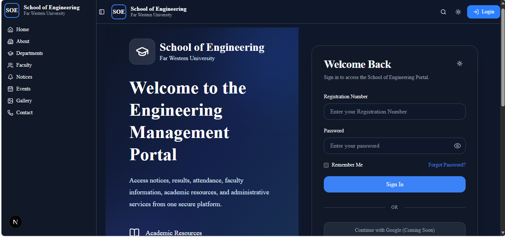
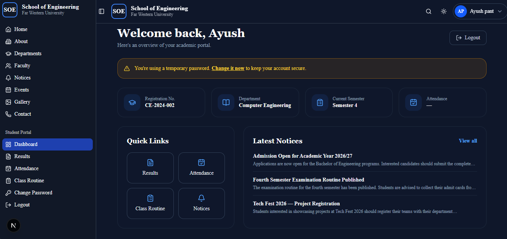
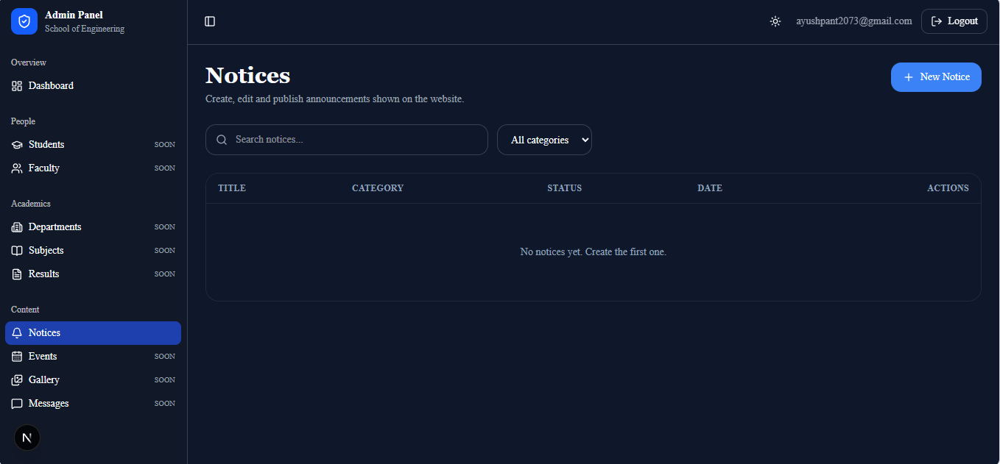

<h1 align="center">Engineering College Management System (ECMS)</h1>

<p align="center">
  A secure, full-stack platform that digitizes the academic and administrative workflows of an engineering college.
</p>

<p align="center">
  
  
  
  
  
  
  
</p>

---

## Screenshots

| Login | Student Dashboard |
| :---: | :---: |
|  |  |

<p align="center"><b>Admin Panel</b></p>
<p align="center">
  
</p>

---

## Overview

ECMS replaces paper-based college processes with a single, centralized platform for students, faculty, administrators and visitors.

- **Visitors** can explore departments, faculty, notices, galleries and contact details on the public website.
- **Students** log in with their registration number to see their dashboard, notices and published semester results.
- **Administrators** manage students, notices and examination results from a dedicated, role-protected panel.
- **Faculty** tools (attendance, assignments, result entry) are on the roadmap.

The backend follows a modular architecture with a clear separation of concerns, so new features can be added without touching existing ones.

## Features and Status

✅ Done &nbsp;·&nbsp; 🚧 In progress &nbsp;·&nbsp; 📋 Planned

| Area | Feature | Status |
| --- | --- | :---: |
| Public website | Departments, faculty, notices, gallery, contact | ✅ |
| Authentication | Student login with registration number | ✅ |
| Authentication | Forced password change on first login | ✅ |
| Authentication | Separate admin login with role-based access control | ✅ |
| Admin panel | Dashboard overview | ✅ |
| Admin panel | Notice management (create, edit, pin, publish as draft) | ✅ |
| Admin panel | Student management (add, edit, reset password, delete) | ✅ |
| Results | Admin marks entry with draft → publish workflow | ✅ |
| Results | Audit log of every mark change, with a required reason for corrections | ✅ |
| Results | Student results page with GPA calculation | 🚧 |
| Academics | Department and subject management | 🚧 |
| Admin panel | Faculty, event and gallery management | 📋 |
| Faculty | Faculty dashboard | 📋 |
| Attendance | Attendance recording and monitoring | 📋 |
| Assignments | Assignment upload and submission | 📋 |
| Documents | PDF marksheet generation | 📋 |
| Files | Secure file uploads | 📋 |
| Tokens | Refresh-token flow | 📋 |
| DevOps | Docker setup and CI/CD pipeline | 📋 |

## Tech Stack

| Layer | Technology | Purpose |
| --- | --- | --- |
| **Frontend** | Next.js (App Router) | Framework, routing, server rendering |
| | TypeScript | Type safety |
| | Tailwind CSS · shadcn/ui | Styling and accessible UI components |
| | React Hook Form · Zod | Form handling and schema validation |
| | Framer Motion | Animations |
| | next-themes | Light / dark theme |
| | TanStack Query *(planned)* | Server-state management |
| **Backend** | NestJS (Express platform) | Modular REST API |
| | TypeScript | Type safety |
| | Prisma ORM | Type-safe database access and migrations |
| | class-validator | Request (DTO) validation |
| | @nestjs/throttler | Rate limiting on sensitive routes |
| **Database** | PostgreSQL | Relational data store |
| **Security** | JWT | Stateless authentication |
| | bcrypt | Password hashing |
| | Role-based guards | Admin / student authorization |
| **Cloud & DevOps** *(planned)* | Cloudinary | File and image storage |
| | Docker | Containerized deployment |
| | GitHub Actions | CI/CD |
| | Vercel · Railway / Render | Hosting |

## Security

- Passwords are hashed with bcrypt and never stored or logged in plain text.
- Admin and student tokens are signed with **different secrets**, so a student token can never be accepted by an admin route.
- Every admin endpoint is protected by a role guard, and the admin login is rate-limited.
- Administrators never choose student passwords: temporary passwords are generated randomly, shown once, and must be changed at first login.
- All request bodies are validated on the server, and published results can only be changed with a recorded reason.
- Result changes are written to an append-only audit log.

## Getting Started

### Prerequisites

- Node.js 20 or later
- PostgreSQL 14 or later
- npm

### 1. Clone the repository

```bash
git clone https://github.com/ayushpant-ui/Engineering-College-Management-System-ECMS.git
cd Engineering-College-Management-System-ECMS
```

### 2. Backend

```bash
cd backend
npm install
```

Create `backend/.env`:

| Variable | Description |
| --- | --- |
| `DATABASE_URL` | PostgreSQL connection string |
| `JWT_ADMIN_SECRET` | Long random secret for admin tokens (must differ from the student secret) |
| `JWT_ADMIN_EXPIRES_IN` | Admin token lifetime, e.g. `30m` |
| `SEED_ADMIN_EMAIL` | Email of the first admin account |
| `SEED_ADMIN_PASSWORD` | Password for that account (12+ characters) |

Generate a secret with `node -e "console.log(require('crypto').randomBytes(64).toString('hex'))"`.

Then set up the database and start the API:

```bash
npx prisma migrate dev
npx prisma generate
npx ts-node prisma/seed-admin.ts   # creates the first admin
npm run start:dev
```

### 3. Frontend

```bash
cd frontend
npm install
```

Create `frontend/.env.local`:

```env
NEXT_PUBLIC_API_URL=http://localhost:4000
```

Use the port your backend actually runs on.

```bash
npm run dev
```

### 4. Open the app

| Page | URL |
| --- | --- |
| Public website | http://localhost:3000 |
| Student login | http://localhost:3000/login |
| Admin login | http://localhost:3000/admin/login |

## Project Structure

```text
ECMS/
├── frontend/   # Next.js app: public website, student portal, admin panel
└── backend/    # NestJS API, Prisma schema and migrations
```

## Roadmap

The next milestones, in order:

1. Connect the student results page to published results
2. Faculty and department management
3. Attendance and assignments
4. PDF marksheets and secure file uploads
5. Refresh tokens, Docker and CI/CD

## About

ECMS is being built as a long-term portfolio project to demonstrate modern full-stack development: scalable architecture, secure backend engineering, relational database design and production-ready deployment workflows.

Developed by [@ayushpant-ui](https://github.com/ayushpant-ui).